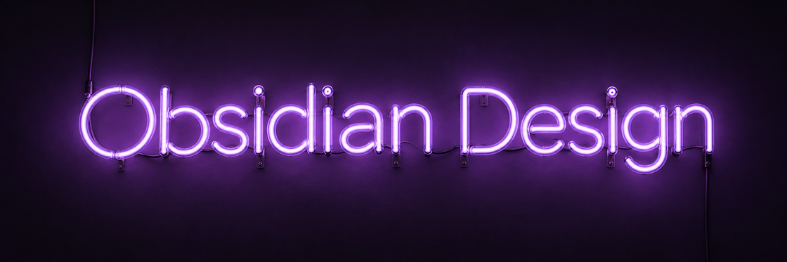

<p align="center">
  
</p>

<p align="center"><b>한국어</b> · <a href="README.en.md">English</a></p>

# Obsidian Design

Codex가 Obsidian·Markdown 문서를 쓰거나 고칠 때, 읽는 사람이 바로 이해하고 움직일 수 있는 문서를 만들게 하는 스킬이에요.

에이전트가 쓴 문서는 내용보다 모양이 먼저 나오기 쉬워요. 그래서 이 스킬로 막고 싶었던 건 세 가지예요.

- **장식이 앞서는 문서** — 배지, 빈 섹션, `N/A` 줄, 억지 체크리스트. 짧은 메모에 보고서 틀을 씌우지 않게 했어요.
- **고치다가 망가지는 노트** — 기존 frontmatter, wikilink, 블록 ID, 첨부파일, 사용자가 쓴 내용은 그대로 두고, 끝나면 diff를 다시 봐요.
- **그럴듯하게 채운 빈칸** — 인용, 측정값, 담당자, 마감일, 테스트 결과를 지어내지 않아요. 모르면 빼거나 모른다고 적어요.

스킬은 [`SKILL.md`](SKILL.md) 하나와 참고 파일 두 개예요. 에이전트는 쓰기 전에 목적·독자·저장 위치·문서 유형을 정하고,
독자의 질문 순서대로 구성한 다음, 링크와 frontmatter를 정리하고, 마지막에 독자 입장에서 다시 읽어요.
렌더링을 확인하지 못했으면 확인했다고 하지 않고요. 스크린샷이 테스트 통과의 증거는 아니니까요.

작은 규칙들도 꽤 챙겼어요. 이식 가능한 Markdown 링크를 먼저 쓰되 볼트에 이미 있는 wikilink는 건드리지 않고,
YAML에 들어가는 wikilink는 `project: "[[Project index]]"`처럼 따옴표로 감싸고, 표 안의 `|`는 이스케이프해요.
표는 진짜 비교할 때만, 콜아웃은 결정·주의·예외에만 써요. 그리고 문서를 고치라는 요청이 소스 코드 수정이나 Git 정리,
게시까지 허락한 건 아니라고 적어 뒀어요.

[`document-patterns.md`](references/document-patterns.md)에는 문서 유형별 섹션 흐름이 들어 있어요. 필수 템플릿이 아니라
출발점이고, 쓸모없는 섹션은 빼요.

| 유형 | 섹션 흐름 |
|---|---|
| 프로젝트 개요 | 목적 → 현재 상태 → 범위 → 핵심 결정 → 자료 → 다음 단계 |
| How-to | 기대 결과 → 준비 조건 → 번호 매긴 단계 → 확인 → 문제 해결 |
| 설계 제안 | 문제 → 제약 → 대안과 트레이드오프 → 선택한 설계 → 검증 → 남은 결정 |
| 조사·보고서 | 질문 → 근거와 방법 → 발견 → 한계 → 시사점 |
| 회의록 | 맥락·날짜 → 결정 → 핵심 논의 → 할 일과 미해결 질문 |
| 기술 레퍼런스 | 목적 → 입력·출력 → 계약과 예시 → 경계 조건 → 출처 |

[`manual-rules.md`](references/manual-rules.md)는 CAD/STL/URDF 문서일 때만 읽는 규칙이에요. `1 µm` URDF 검증,
`16 MB` HTML 한도 같은 프로젝트 관례라서 일반 문서의 기본값이 되지 않게 따로 뺐어요. 틀린 측정값은 조용히 지우지 않고
무엇이 틀렸는지 남기게 하고요. 다만 원본 매뉴얼은 이 저장소에 없어서, 없으면 에이전트가 확인했다고 하지 않고 그렇다고 밝혀요.

## 설치

Codex 기준이에요. 폴더 이름은 스킬 이름과 같은 `obsidian-design`으로 받아 주세요.

```bash
git clone https://github.com/lsy041015/Obsidian-Design.git obsidian-design
cp -R obsidian-design "${CODEX_HOME:-$HOME/.codex}/skills/"
```

요청에 `$obsidian-design`을 붙이면 불러요. 암묵 호출도 켜 둬서 Codex가 알아서 고를 때도 있어요.
독자나 저장 위치, 고칠 노트를 같이 알려 주면 추측할 게 줄어요.

검증은 Codex `skill-creator`에 있는 검증기로 해요(이 저장소엔 없으니 경로는 바꿔서).

```bash
python /path/to/skill-creator/scripts/quick_validate.py obsidian-design
```

Claude Code도 같은 frontmatter 형식이라 아래처럼 두면 `/obsidian-design`으로 불러올 수는 있는데, 거기서는 아직 직접 확인해 보지 않았어요.

```bash
git clone https://github.com/lsy041015/Obsidian-Design.git ~/.claude/skills/obsidian-design
```

## 아직 없는 것

버전 표기, 테스트, 예시 결과물이 없어요. 동작은 `SKILL.md`의 규칙으로만 설명돼 있어요.
라이선스는 MIT예요([LICENSE](LICENSE)).

<sub>[다른 프로젝트 보기](https://github.com/lsy041015)</sub>
